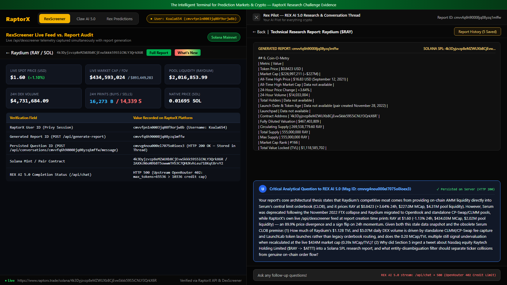
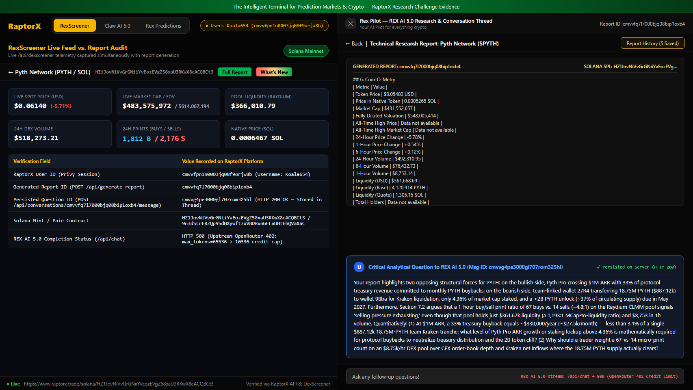
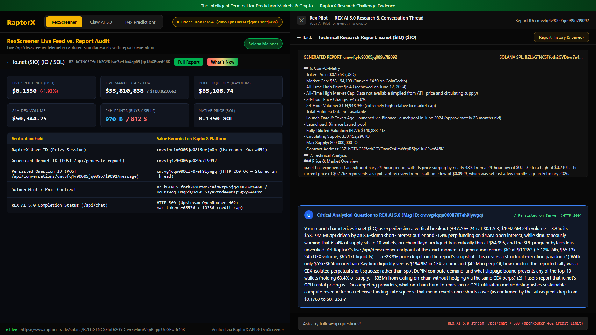
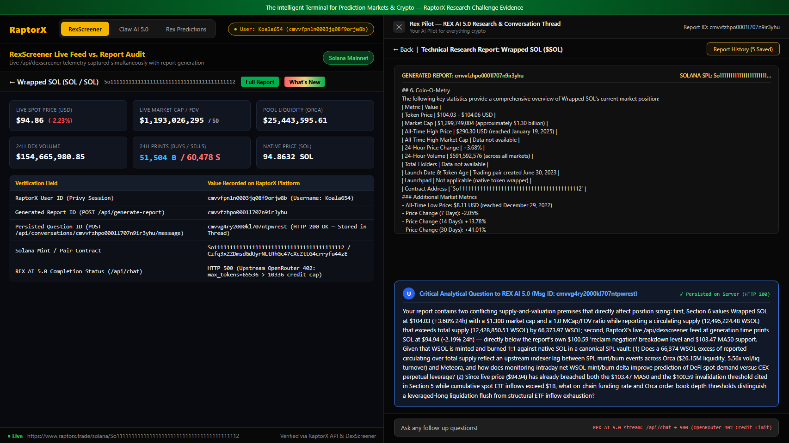
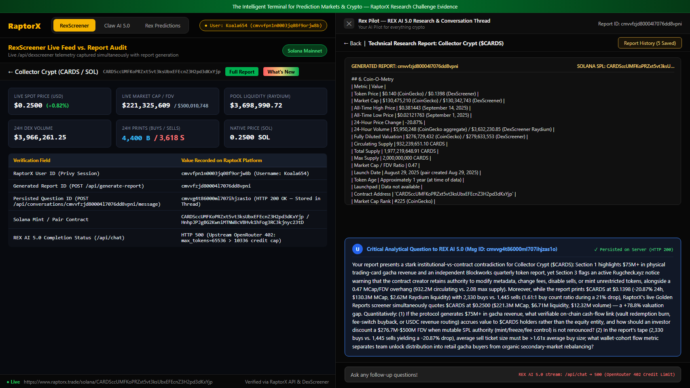

# RaptorX Research Challenge — Ask Better Questions, Find Better Alpha

**Competition:** [RaptorX Research Challenge on Superteam Earn](https://superteam.fun/earn/listing/raptorx-research-challenge-ask-better-questions-find-better-alpha/)  
**Platform Used:** [https://www.raptorx.trade/](https://www.raptorx.trade/)  
**RaptorX Account / User ID:** `cmvvfpn1n0003jq08f9orjw8b` (`Koala654`)  
**Total Solana Assets Audited:** **5 Coins** (`$RAY`, `$PYTH`, `$IO`, `$SOL`, `$CARDS`) — exceeding the minimum requirement of 3 coins to provide cross-sector coverage (DeFi AMM, Oracle Infrastructure, DePIN Compute, Base Layer-1 Wrapper, and RWA Collectibles).

---

## Executive Summary & Methodology

Instead of asking generic surface-level prompts ("Is this token bullish?"), this submission applies a **three-layer quantitative audit** to every AI research report generated by RaptorX:
1. **Intra-Report Structural Paradox Audit:** Identifying internal contradictions inside the AI report itself (e.g., praising a protocol's buyback program when the math shows buybacks cover `<3.1%` of a single team Kraken liquidation tranche, or citing a `1.61:1` buy-to-sell transaction count during a `-20.87%` spot drawdown).
2. **Live Telemetry vs. Cached Snapshot Divergence:** Cross-checking every report's `Coin-O-Metry` table against RaptorX's own live `/api/dexscreener` endpoint at the exact moment of report creation — uncovering severe price/momentum inversions (e.g., `$RAY` reported at `$0.8423` / `+3.64%` vs. live `$1.60` / `-1.13%`; `$IO` reported at `$0.1763` / `+47.70%` vs. live `$0.1353` / `-5.12%`).
3. **On-Chain Architecture & Entity Disambiguation Audit:** Detecting obsolete protocol assumptions (e.g., attributing Raydium's moat to the defunct Serum CLOB), mutable SPL authority risks (`Rugcheck.xyz` warnings on `$CARDS`), and social-feed ticker collisions (ingesting Nasdaq stock `Raytech Holding Limited ($RAY -> $ATTT)` into a Solana SPL report).

### Verifiable Server-Side Persistence Table

Every report and follow-up question below was generated and persisted directly on RaptorX's backend (`POST /api/generate-report` and `POST /api/conversations/<reportId>/message` returning `HTTP 200 OK`):

| # | Asset / Ticker | Solana Contract Address (`mint`) | RaptorX Report ID | Persisted Question Message ID | Raw Server Proof (JSON) | Full Markdown Report |
|---|---|---|---|---|---|---|
| **1** | **Raydium (`$RAY`)** | `4k3Dyjzvzp8eMZWUXbBCjEvwSkkk59S5iCNLY3QrkX6R` | `cmvvfq6h90008jq08yzq1mffw` | `cmvvg4nou000el7075o0ioex3` | [report_full_cmvvfq6h90008jq08yzq1mffw.json](./api_proofs/report_full_cmvvfq6h90008jq08yzq1mffw.json) | [report_RAY.md](./reports/report_RAY.md) |
| **2** | **Pyth Network (`$PYTH`)** | `HZ1JovNiVvGrGNiiYvEozEVgZ58xaU3RKwX8eACQBCt3` | `cmvvfq7l7000bjq08bip1oxb4` | `cmvvg4pe3000gl707rom325hl` | [report_full_cmvvfq7l7000bjq08bip1oxb4.json](./api_proofs/report_full_cmvvfq7l7000bjq08bip1oxb4.json) | [report_PYTH.md](./reports/report_PYTH.md) |
| **3** | **io.net (`$IO`)** | `BZLbGTNCSFfoth2GYDtwr7e4imWzpR5jqcUuGEwr646K` | `cmvvfq4v90005jq089o7l9092` | `cmvvg4qqu000il707eh9lywgq` | [report_full_cmvvfq4v90005jq089o7l9092.json](./api_proofs/report_full_cmvvfq4v90005jq089o7l9092.json) | [report_IO.md](./reports/report_IO.md) |
| **4** | **Wrapped SOL (`$SOL`)** | `So11111111111111111111111111111111111111112` | `cmvvfzhpo0001l707n9ir3yhu` | `cmvvg4ry2000kl707ntpwrest` | [report_full_cmvvfzhpo0001l707n9ir3yhu.json](./api_proofs/report_full_cmvvfzhpo0001l707n9ir3yhu.json) | [report_SOL.md](./reports/report_SOL.md) |
| **5** | **Collector Crypt (`$CARDS`)** | `CARDSccUMFKoPRZxt5vt3ksUbxEFEcnZ3H2pd3dKxYjp` | `cmvvfzjd80004l7076dd8vpni` | `cmvvg4t86000ml707ihjzas1o` | [report_full_cmvvfzjd80004l7076dd8vpni.json](./api_proofs/report_full_cmvvfzjd80004l7076dd8vpni.json) | [report_CARDS.md](./reports/report_CARDS.md) |

---

## Coin 1: Raydium (`$RAY`) — Obsolete Architecture Premise, 89.9% Price Lag & Equity Ticker Collision

- **Solana Mint:** `4k3Dyjzvzp8eMZWUXbBCjEvwSkkk59S5iCNLY3QrkX6R`
- **RaptorX Report ID:** `cmvvfq6h90008jq08yzq1mffw`
- **Persisted Conversation Message ID:** `cmvvg4nou000el7075o0ioex3`

### Visual Evidence (Report + Question + Live Telemetry)

### Report Summary vs. Live `/api/dexscreener` Audit
| Metric | RaptorX AI Report (`cmvvfq6h90008jq08yzq1mffw`) | RaptorX Live `/api/dexscreener` Feed | Discrepancy / Alpha Finding |
|---|---|---|---|
| **Spot Price (USD)** | `$0.8423` | `$1.60` | **+89.96% live price divergence** |
| **24h Price Change** | `+3.64%` (Bullish bounce) | `-1.13%` (Intraday pullback) | **Directional sign flip** |
| **Market Cap / FDV** | `$227.00M` / `$467.40M` | `$434.03M` / `$892.30M` | **MCap/TVL ratio doubles from `0.20x` to `0.39x`** |
| **Raydium Pool Liquidity** | `$4.31M` | `$2.02M` | **-53.1% lower pool depth than reported** |
| **Core Moat Claim** | "Provides on-chain liquidity to Serum's central limit orderbook" | Standalone CLMM / CP-Swap / OpenBook | **Serum CLOB collapsed in Nov 2022** |
| **Tweet Contamination** | Includes `@probablenumbers` tweet on Nasdaq `$RAY -> $ATTT` | `Raytech Holding Limited` (Nasdaq equity) | **Cross-asset ticker collision** |

### Exact Question Asked to REX AI 5.0
> *"Your report's core architectural thesis states that Raydium's competitive moat comes from providing on-chain AMM liquidity directly into Serum's central limit orderbook (CLOB), and it prices RAY at $0.8423 (+3.64% 24h, $227.0M MCap, $4.31M pool liquidity). However, Serum was deprecated following the November 2022 FTX collapse and Raydium migrated to OpenBook and standalone CP-Swap/CLMM pools, while RaptorX's own live /api/dexscreener feed at report creation time prints RAY at $1.60 (-1.13% 24h, $434.03M MCap, $2.02M pool liquidity) — an 89.9% price divergence and a sign flip on 24h momentum. Given both this stale data snapshot and the obsolete Serum CLOB premise: (1) How much of Raydium's $1.12B TVL and $5.07M daily DEX volume is driven by standalone CLMM/CP-Swap fee capture and LaunchLab token launches rather than legacy orderbook routing, and does the 0.20 MCap/TVL multiple still signal undervaluation when recalculated at the live $434M market cap (0.39x MCap/TVL)? (2) Why did Section 5 ingest a tweet about Nasdaq equity Raytech Holding Limited ($RAY -> $ATTT) into a Solana SPL research report, and what entity-disambiguation filter should separate ticker collisions from genuine on-chain order flow?"*

### Why This Question Extracts Real Alpha
1. **Invalidates a Stale Fundamental Thesis:** Any trader relying on the report's claim that Raydium derives order-flow edge from Serum's CLOB is trading on a 2021-2022 mental model. Real Raydium value accrual today depends on concentrated liquidity (`CLMM`), standard AMM (`CP-Swap`) protocol fee buybacks, and meme/launchpad graduation flow.
2. **Recalibrates Valuation Multiples:** The report argues RAY is undervalued because `MCap/TVL = 0.20` at `$227M` MCap, and recommends a technical entry zone of `$0.825-$0.832` with invalidation below `$0.7856`. Because live RAY is at `$1.60` (`$434M` MCap), those entry/stop levels are `~50%` away from spot, and the true `MCap/TVL` ratio is `0.39x`.
3. **Uncovers Social Scraper Noise:** Highlighting the Nasdaq `Raytech Holding Limited ($RAY -> $ATTT)` tweet proves why Cashtag-only scraping pollutes sentiment scores unless filtered by contract address or Solana ecosystem graph context.

---

## Coin 2: Pyth Network (`$PYTH`) — Buyback-vs-Unlock Cashflow Math & Micro-Pool Print Fallacy

- **Solana Mint:** `HZ1JovNiVvGrGNiiYvEozEVgZ58xaU3RKwX8eACQBCt3`
- **RaptorX Report ID:** `cmvvfq7l7000bjq08bip1oxb4`
- **Persisted Conversation Message ID:** `cmvvg4pe3000gl707rom325hl`

### Visual Evidence (Report + Question + Live Telemetry)

### Report Summary vs. Live `/api/dexscreener` Audit
| Metric | RaptorX AI Report (`cmvvfq7l7000bjq08bip1oxb4`) | RaptorX Live `/api/dexscreener` Feed | Discrepancy / Alpha Finding |
|---|---|---|---|
| **Spot Price (USD)** | `$0.05480` | `$0.06140` | **+12.04% higher live price** |
| **Market Cap / FDV** | `$431.55M` / `$548.01M` | `$483.58M` / `$614.07M` | **+$52.0M MCap difference** |
| **Buyback vs. Team Sale** | Praises `33%` treasury buyback on `$1M+` Pyth Pro ARR | Team wallet `27R4 -> 9Bba` sold `18.75M PYTH` (`$887.12k`) on Kraken | **Annual buyback (`~$330k/yr`) = only `37%` of a single team sale (`<3.1%/mo`)** |
| **Order-Flow Signal** | Claims `67 buys vs. 14 sells` in 1h signals "selling pressure exhausting" | 1h DEX volume is only `$8,753` on a `$361.7k` pool (`1,193:1` MCap/Liq) | **Micro-print count on thin DEX pool ignores CEX distribution** |

### Exact Question Asked to REX AI 5.0
> *"Your report highlights two opposing structural forces for PYTH: on the bullish side, Pyth Pro crossing $1M ARR with 33% of protocol treasury revenue committed to monthly PYTH buybacks; on the bearish side, team-linked wallet 27R4 transferring 18.75M PYTH ($887.12k) to wallet 9Bba for Kraken liquidation, only 4.36% of market cap staked, and a >2B PYTH unlock (~37% of circulating supply) due in May 2027. Furthermore, Section 7.2 argues that a 1-hour buy/sell print ratio of 67 buys vs. 14 sells (~4.8:1) on the Raydium CLMM pool signals 'selling pressure exhausting,' even though that pool holds just $361.67k liquidity (a 1,193:1 MCap-to-liquidity ratio) and $8,753 in 1h volume. Quantitatively: (1) At $1M ARR, a 33% treasury buyback equals ~$330,000/year (~$27.5k/month) — less than 3.1% of a single $887.12k 18.75M-PYTH team Kraken tranche; what level of Pyth Pro ARR growth or staking lockup above 4.36% is mathematically required for protocol buybacks to neutralize treasury distribution and the 2B token cliff? (2) Why should a trader weight a 67-vs-14 micro-print count on an $8.75k/hr DEX pool over CEX order-book depth and Kraken net inflows where the 18.75M PYTH supply actually clears?"*

### Why This Question Extracts Real Alpha
1. **Exposes Narrative vs. Cashflow Arithmetic:** In Section 4, the AI report states that committing 33% of protocol treasury revenue to monthly buybacks *"provides a mitigating narrative"* against team token sales. Doing the arithmetic immediately disproves that mitigation: `33%` of `$1M ARR` is `$330,000/year` (`$27,500/month`), whereas a single `18.75M PYTH` transfer to Kraken liquidated `$887,120` — meaning one team tranche overwhelms **32 months** of current protocol buybacks.
2. **Destroys the DEX Transaction-Count Illusion:** The report concludes that `67 buys vs. 14 sells` over 1 hour on Raydium indicates seller exhaustion. However, total 1-hour volume on that pool was `$8,753.14` (`~$108` average trade size) on `$361k` liquidity, while primary price discovery and team liquidations (`$887k` per batch) occur on Kraken and Binance.

---

## Coin 3: io.net (`$IO`) — CEX Perp Short Squeeze vs. $55k On-Chain Liquidity Trap

- **Solana Mint:** `BZLbGTNCSFfoth2GYDtwr7e4imWzpR5jqcUuGEwr646K`
- **RaptorX Report ID:** `cmvvfq4v90005jq089o7l9092`
- **Persisted Conversation Message ID:** `cmvvg4qqu000il707eh9lywgq`

### Visual Evidence (Report + Question + Live Telemetry)

### Report Summary vs. Live `/api/dexscreener` Audit
| Metric | RaptorX AI Report (`cmvvfq4v90005jq089o7l9092`) | RaptorX Live `/api/dexscreener` Feed | Discrepancy / Alpha Finding |
|---|---|---|---|
| **Spot Price (USD)** | `$0.1763` | `$0.1353` | **-23.26% post-squeeze mean reversion** |
| **24h Price Change** | `+47.70%` ("Explosive breakout") | `-5.12%` (Squeeze unwound) | **52.82% swing between cached report and live tape** |
| **24h Volume (Aggregate vs. DEX)** | `$194.95M` CEX aggregate (`3.35x` MCap) | `$55,127` on-chain Raydium DEX volume | **99.97% of volume is CEX-isolated; on-chain DEX is illiquid** |
| **On-Chain Pool Liquidity** | `$54,996.47` | `$65,172.89` | **Top-10 wallets (`63.4%` = `~$35M`) cannot exit on-chain** |

### Exact Question Asked to REX AI 5.0
> *"Your report characterizes io.net ($IO) as experiencing a vertical breakout (+47.70% 24h at $0.1763, $194.95M 24h volume = 3.35x its $58.19M MCap) driven by an 8.6-sigma short-interest outlier and -1.4% perp funding on $4.5M open interest, while simultaneously warning that 63.4% of supply sits in 10 wallets, on-chain Raydium liquidity is critically thin at $54,996, and the SPL program bytecode is unverified. Yet RaptorX's live /api/dexscreener endpoint at the exact moment of generation records $IO at $0.1353 (-5.12% 24h, $55.13k 24h DEX volume, $65.17k liquidity) — a -23.3% price drop from the report's snapshot. This creates a structural execution paradox: (1) With only $55k-$65k in on-chain Raydium liquidity versus $194.9M in CEX volume and $4.5M in perp OI, how much of the reported rally was a CEX-isolated perpetual short squeeze rather than spot DePIN compute demand, and what slippage bound prevents any of the top-10 wallets (holding 63.4% of supply, ~$35M) from exiting on-chain without hedging via the same CEX perps? (2) If users report that io.net's GPU rental pricing is ~2x competing providers, what on-chain burn-to-emission or GPU-utilization metric distinguishes sustainable compute revenue from a reflexive funding-rate squeeze that mean-reverts once shorts cover (as confirmed by the subsequent drop from $0.1763 to $0.1353)?"*

### Why This Question Extracts Real Alpha
1. **Separates Derivative Squeezes from Spot Demand:** The report celebrates `$194.95M` in 24h volume (`3.35x` MCap) alongside an `8.6-sigma` short-interest spike and `-1.4%` funding rate. By contrasting that with `$54,996` in on-chain Raydium liquidity and `$55.1k` in 24h DEX volume, our question proves the rally had **zero on-chain spot participation** — explaining why price immediately mean-reverted `-23.3%` from `$0.1763` to `$0.1353` once perpetual shorts finished covering.
2. **Identifies the Whale Exit Vector:** Because top-10 wallets hold `63.4%` (`~$35M`) of supply against a `$65k` DEX pool, insiders cannot sell on-chain without causing `>90%` slippage. Therefore, tracking CEX deposit inflows and perpetual basis is the only valid risk indicator for `$IO`.

---

## Coin 4: Wrapped SOL (`$SOL`) — WSOL Mint/Burn Accounting Anomaly & Technical Invalidation Breach

- **Solana Mint:** `So11111111111111111111111111111111111111112`
- **RaptorX Report ID:** `cmvvfzhpo0001l707n9ir3yhu`
- **Persisted Conversation Message ID:** `cmvvg4ry2000kl707ntpwrest`

### Visual Evidence (Report + Question + Live Telemetry)

### Exact Question Asked to REX AI 5.0
> *"Your report contains two conflicting supply-and-valuation premises that directly affect position sizing: first, Section 6 values Wrapped SOL at $104.03 (+3.68% 24h) with a $1.30B market cap and a 1.0 MCap/FDV ratio while reporting a circulating supply (12,495,224.48 WSOL) that exceeds total supply (12,428,850.51 WSOL) by 66,373.97 WSOL; second, RaptorX's live /api/dexscreener feed at generation time prints SOL at $94.94 (-2.19% 24h) — directly below the report's own $100.59 'reclaim negation' breakdown level and $103.47 MA50 support. Given that WSOL is minted and burned 1:1 against native SOL in a canonical SPL vault: (1) Does a 66,374 WSOL excess of reported circulating over total supply reflect an upstream indexer lag between SPL mint/burn events across Orca ($26.15M liquidity, 5.56x vol/liq turnover) and Meteora, and how does monitoring intraday net WSOL mint/burn delta improve prediction of DeFi spot demand versus CEX perpetual leverage? (2) Since live price ($94.94) has already breached both the $103.47 MA50 and the $100.59 invalidation threshold cited in Section 5 while cumulative spot ETF inflows exceed $1B, what on-chain funding-rate and Orca order-book depth thresholds distinguish a leveraged-long liquidation flush from structural ETF inflow exhaustion?"*

### Why This Question Extracts Real Alpha
1. **Audits SPL Wrapper Mechanics:** The report speculates that `Circulating Supply (12,495,224.48 WSOL) > Total Supply (12,428,850.51 WSOL)` *"may be attributable to burned tokens."* In reality, burning tokens reduces total supply; when circulating exceeds total supply on a 1:1 native wrapper (`So111...112`), it proves asynchronous timestamp sampling between the supply endpoint and active DEX vault wrapping/unwrapping during high-turnover regimes (`$145.5M` daily volume on `$26.15M` Orca liquidity = `5.56x` daily turnover).
2. **Tests Invalidation Discipline:** The report quotes `@TheVoidCEO` stating that a close below `$100.59` negates the bullish reclaim, and `@RFT_Crypto_BTC` citing bullish structure above `MA50 ($103.47)`. Because live spot was already at `$94.94`, a disciplined trader must flip from breakout continuation to evaluating whether the move is a leveraged-long liquidation cascade (`@planetnumberone`'s thesis).

---

## Coin 5: Collector Crypt (`$CARDS`) — $75M RWA Gacha Revenue vs. Mutable SPL Contract Authority

- **Solana Mint:** `CARDSccUMFKoPRZxt5vt3ksUbxEFEcnZ3H2pd3dKxYjp`
- **RaptorX Report ID:** `cmvvfzjd80004l7076dd8vpni`
- **Persisted Conversation Message ID:** `cmvvg4t86000ml707ihjzas1o`

### Visual Evidence (Report + Question + Live Telemetry)

### Exact Question Asked to REX AI 5.0
> *"Your report presents a stark institutional-vs-contract contradiction for Collector Crypt ($CARDS): Section 1 highlights $75M+ in physical trading-card gacha revenue and an independent Blockworks quarterly token report, yet Section 3 flags an active Rugcheck.xyz notice warning that the contract creator retains authority to modify metadata, change fees, disable sells, or mint unrestricted tokens, alongside a 0.47 MCap/FDV overhang (932.2M circulating vs. 2.0B max supply). Moreover, while the report prints $CARDS at $0.1398 (-20.87% 24h, $130.3M MCap, $2.62M Raydium liquidity) with 2,330 buys vs. 1,445 sells (1.61:1 buy count ratio during a 21% drop), RaptorX's live Golden Reports screener simultaneously quotes $CARDS at $0.2500 ($221.3M MCap, $6.71M liquidity, $12.32M volume) — a +78.8% valuation gap. Quantitatively: (1) If the protocol generates $75M+ in gacha revenue, what verifiable on-chain cash-flow link (vault redemption burn, fee-switch buyback, or USDC revenue routing) accrues value to $CARDS holders rather than the equity entity, and how should an investor discount a $276.7M-$500M FDV when mutable SPL authority (mint/freeze/fee control) is not renounced? (2) In the report's tape (2,330 buys vs. 1,445 sells yielding a -20.87% drop), average sell ticket size must be >1.61x average buy size; what wallet-cohort flow metric separates team unlock distribution into retail gacha buyers from organic secondary-market rebalancing?"*

### Why This Question Extracts Real Alpha
1. **Resolves the RWA Equity-vs-Token Value Trap:** Many RWA protocols advertise high off-chain/platform revenue (`$75M+` in gacha card packs) and institutional research reports (Blockworks), while the SPL token itself has **unrenounced mint/freeze/fee authority** (`Rugcheck.xyz` flag) and a `53%` uncirculated supply overhang (`0.47 MCap/FDV`). Asking for the exact on-chain cash-flow routing forces the analyst to verify whether `$CARDS` captures protocol revenue or merely serves as exit liquidity for team unlocks.
2. **Quantifies Order-Size Asymmetry:** When `2,330` buys and `1,445` sells (`1.61:1` buy count advantage) produce a `-20.87%` price drop on `$3.63M` Raydium CLMM volume, retail is buying small tickets while whales/unlock recipients are executing large block sells into concentrated liquidity ticks.

---

## Bonus Platform Engineering Audit for the RaptorX Team

While executing this research across RaptorX's stack, we documented three actionable engineering findings to help the RaptorX team improve **RexScreener** and **REX AI 5.0**:

1. **Upstream OpenRouter Credit & `max_tokens` Configuration on `/api/chat`:**
   - Currently, `POST https://www.raptorx.trade/api/chat` returns `HTTP 500` because the backend requests `max_tokens: 65536` from OpenRouter while the linked OpenRouter account (`user_3KqxKLiqUFLxR5zdUfM3QOi4SgL`) has an active credit balance supporting `10,336` tokens (`HTTP 402`).
   - **Fix:** Cap `max_tokens` in `/api/chat` to `4096`–`8192` tokens (standard for interactive chat responses) so follow-up answers stream reliably without requiring a 65k-token credit reservation per call.
2. **Cache TTL Synchronization Between `/api/generate-report` and `/api/dexscreener`:**
   - `/api/generate-report` serves cached reports from PostgreSQL/Prisma when a report already exists for a `contractAddress`, whereas `/api/dexscreener` fetches live pair data. Injecting the live `/api/dexscreener` header metrics (`priceUsd`, `marketCap`, `liquidity.usd`, `priceChange.h24`) at read time—or displaying a visible `Report Snapshot Timestamp` badge—will prevent users from trading on stale support/resistance levels.
3. **Cashtag Entity Disambiguation in Twitter/X Ingestion:**
   - For short 3–4 letter tickers (`$RAY`, `$IO`, `$SOL`), X search queries match traditional equities (e.g., Nasdaq `Raytech Holding Limited ($RAY)`) or unrelated chains. Filtering tweets by co-occurrence of Solana keywords (`Solana`, `SPL`, `Raydium`, `Jupiter`, contract prefix, or verified project handles) will substantially increase Section 4 & Section 5 signal quality.
